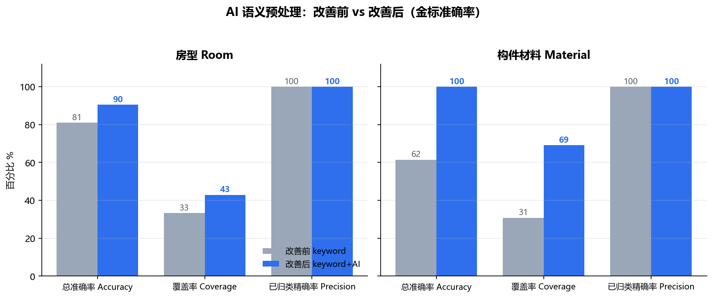
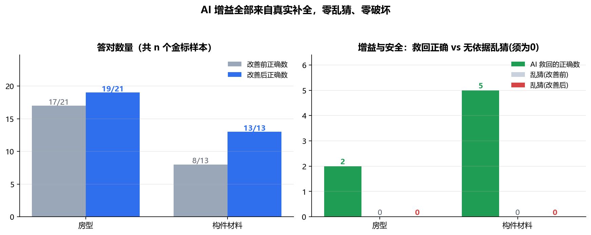

# AI 语义预处理层（判断层·隐形增强）方案设计

> 日期：2026-09-15
> 状态：设计稿，待执行
> 关联文档：`AI边界仲裁Agent方案设计_2026-09-14.md`（本方案替代其"判定后仲裁"路线）

---

## 1. 背景与转变

上一版做的是**判定后可见仲裁**：规则判完 → 对边界问题弹"AI 仲裁"按钮/横幅/标签让用户点。
问题：① 界面乱；② AI 站在"判官"位置，违背"规则引擎负责判"的分工；③ 需要用户操作，没有真正提升自动判定精度。

**新思路（本方案）**：把 AI 从判定之后挪到判定之前，并且**完全隐形**。
AI 不做判定、不改任何数字，只在规则运行前"读懂描述"——把模型里混乱、多语言、自由填写的
**房间用途 / 构件类型 / 材料 / 系统归属**归一化成规则能直接消费的标准枚举值。
规则引擎拿到的输入更准，自然判得更准。用户只看到"结果更准了"，看不到 AI。

> 一句话：**模型负责读懂，规则负责判。** 把"读"这一层用真正的大模型加强。

---

## 2. 管线位置（Reader→Judge 之间新增一层，无 UI）

```
IFC
 → ① BIM Reader   几何/材料/名称照读；关键词粗分类（现有 extractor）
 → ② AI 语义预处理层（新增·隐形）  ← agents/enricher.py
 ·· 房间用途归一化（重点）
 ·· 结构构件材料归一化 + 混凝土适用性（重点）
 ·· 管道系统归一化（兜底规则已有的补充）
 → ③ 合规判定引擎（规则/阈值/操作符一字不改，仍完全确定、可复算、可审计）
 → 审查报告
```

调用点：`build_review_data(...)` 产出 `bdata` 之后、`run_full_review(bdata)` 之前，
执行一次 `enrich_review_data(bdata)`，原地补全语义字段并记录出处。演示数据（无这些字段）自动跳过。

---

## 3. AI 处理的四类语义（本期落地前两类，架构全部支持）

### 3.1 房间用途归一化（重点）
- 现状：`bim/extractor.py::_classify_room_type` 只靠名称关键词，名字没关键词即 `Unknown`；
  德语、缩写、客户自填用途识别不到——这是互检"分类"维度仅 **24.2%** 的直接原因。
- 增强：对 `type == "Unknown"` 的房间，把 `name + LongName/ObjectType 等描述 + 面积等上下文`
  打包问一次大模型，返回**受控词表内**的标准房型。

### 3.2 结构构件材料归一化（重点，直接消误报）
- 现状：`_elem_material` 返回自由文本材料名（如德语 `Holz`、`Beton C25/30`），规则无法用。
- 新增字段 `material_class ∈ {concrete, steel, wood, masonry, composite, unknown}`：
  先由确定性关键词分类（Beton→concrete、Holz→wood、Stahl→steel…），AI 只在结论模糊时复核。
- **木柱案例**：FZK 模型里那根德语命名的木柱，以前要靠判完后仲裁解释"混凝土柱规则不适用"；
  现在预处理直接给它标 `material_class=wood`，STR-001 的适用条件**天然不触发，从源头不误报**。
300/400 mm 该用哪个限值由归一化后的结构语境字段决定，不再弹窗问人。

### 3.3 管道系统归一化（补充）
`_classify_pipe_type` 同样靠名称/系统关键词。对 `pipe_type == unknown` 的管道批量语义识别为
`fire / water / drainage / hvac / electrical / unknown` 受控值。

### 3.4 客户/材料自由描述（架构预留）
预留一个通用"描述→{类别, 是否人员密集, 备注}"的批量入口，供后续对接客户输入面板，本期不做 UI。

---

## 4. 五条工程约束（保证"不乱、不危险"）

| # | 约束 | 落地方式 |
|---|------|----------|
| 1 | **只填空、只在没把握时出手** | 关键词高置信已分类的不送 AI；只处理 `Unknown` / `unknown` / 被标记低置信对象 |
| 2 | **几何数字一个都不许改** | AI 只能写语义枚举字段（房型/material_class/pipe_type）；尺寸、面积、距离、计数等事实数据只读 |
| 3 | **受控词表 + JSON Schema 校验** | 模型只能从给定枚举里选；越界值丢弃；自由文本只进 central provenance 的 `reason`，不进判定 |
| 4 | **带出处和置信度、集中记账** | 每条 AI 结论记 `{原→新, 来源, 置信度, 理由}`，存 `bdata["_enrichment"]`；**不**给每个房间/构件塞杂乱字段。需要时可在构件详情用一行小字"AI 识别"，不做横幅/徽标/待办 |
| 5 | **批量一次调用 + 哈希缓存 + 优雅降级** | 整栋楼待识别对象**一次**调用（非逐构件）；以 GlobalId+描述哈希做磁盘缓存，二次审查零开销；LLM 未配置/超时/返回非法时回退到现有关键词结果，行为与今天完全一致，流程不阻塞 |

---

## 5. 数据结构

### 5.1 房间（就地更新 `type`，原始即 Unknown 无需保留）
```jsonc
// floor.rooms[i]
{ "id": "...", "name": "Besprechungszimmer", "type": "Meeting Room", /* 其余规则字段不变 */ }
```

### 5.2 结构构件（新增 material_class，不动 material 原文与几何）
```jsonc
// floor.structural_elements[i]
{ "id": "...", "element_type": "column",
  "material": "Holz",            // 原文，保留
  "material_class": "wood",      // 新增受控枚举
  "section_min_m": 0.18, ... }   // 几何只读
```

### 5.3 集中出处台账 `bdata["_enrichment"]`
```jsonc
{
  "enabled": true,
  "llm_used": true,
  "rooms":    { "<id>": { "from": "Unknown", "to": "Meeting Room",
                          "source": "ai", "confidence": "high", "reason": "…" } },
  "elements": { "<id>": { "field": "material_class", "from": "unknown", "to": "wood",
                          "source": "ai|keyword", "confidence": "high", "reason": "…" } },
  "pipes":    { "<id>": { "from": "unknown", "to": "fire", "source": "ai", "confidence": "medium" } },
  "stats":    { "candidates": 12, "ai_resolved": 9, "rejected": 1, "cached": 2 }
}
```

### 5.4 规则侧消费（确定性，无需仲裁标签）
扩展规则引擎的适用条件：除现有单个 `condition_*` 外，新增可选 `conditions_all`
（多个条件 AND；某附加条件字段在 item 中**完全不存在**时忽略该条件，保证旧数据/演示数据行为不变）。

`STR-001`（柱最小截面）新增适用性约束：
```jsonc
"conditions_all": [
  { "field": "material_class", "operator": "not_in",
    "threshold": ["wood", "steel", "masonry"] }
]
```
`unknown`（无法确认，含 AI 关闭时）**仍然触发**——保守、与现状一致；只有被明确识别为
木/钢/砌材的非混凝土柱才排除。几何阈值 300 mm 不变。

---

## 6. 实现清单与顺序

1. `agents/enricher.py`：受控词表常量、确定性材料分类、候选收集（只收不确定项）、
   一次 LLM 批量调用、Schema 校验合并、磁盘缓存、`enrich_review_data(bdata)` 总入口、降级。
2. `core/engine.py::_rule_applies`：支持可选 `conditions_all`（缺失字段忽略）。
3. 调用点（`app.py` 上传分支 + 可复跑入口；批量脚本同用）：
   `bdata = build_review_data(struct)` → `enrich_review_data(bdata)` → 缓存进 session。
4. 规则数据：`STR-001` 加 `conditions_all`；房型相关规则无需改（消费的还是 `type`，只是值更准）。
5. 移除上一版可见仲裁：`app.py` 横幅 / ⚖️徽标 / 筛选 / 展开块全部撤掉；`agents/arbitrator.py` 保留不挂载。
6. 回归对比：31 模型 + 互检 v6，对比增强前后。

---

## 7. 如何验证有用（量化验收）

| 指标 | 预期 |
|------|------|
| `Unknown` 房间数（多语言真实模型，LLM 在线时） | 显著下降 |
| 木/钢/砌材柱的混凝土规则误报 | 消除（STR-001 适用性条件不再触发，**离线确定性即生效**） |
| 几何/计数/存在性维度 | **数字完全不变**（AI 只动语义，不碰事实数据） |
| 关 LLM / 断代理 | 除材料适用性外行为与今天一致；房型归一化回退为关键词（降级安全） |

### 7.1 口径说明：互检"分类 24.2%"不在本层直接改动范围
互检脚本 `scripts/crosscheck_ifc.py` 的"分类"维度比对的是 **BIM Reader 的原始 `parse_model` 结构**；
本层位于 `build_review_data` 之后、只作用于送入规则引擎的 review 数据，因此它提升的是
**审查引擎实际消费的房型/材料语义（判定精度）**，不直接改变互检报告里那个 24.2%。
若日后要让互检分类指标也上升，需要把同一套归一化前移进 `parse_model`（列为后续可选工作，本期不做）。

### 7.2 本期实测（2026-09-15，LLM 代理离线 → 仅确定性材料归一化生效）
- 单测：`Holz→wood`、`Beton C25/30→concrete`、`Stahl→steel`、空→`unknown`；
  STR-001 对木柱 `applies=False`、未知材料柱 `True`（保守）、无该字段的旧数据 `True`（向后兼容）。
- FZK_Haus / FZK-Archicad11 / Jasmin 三个真实模型，增强 **off vs on**：
  违规总数 delta 均为 **0**（无回归），`material_class` 全部填充；未引入任何几何/计数变化。
- AppTest 无头渲染：0 异常，仲裁横幅已消失。
- LLM 在线后，`Unknown` 房型与未知材料会走批量 AI（一次调用 + 内容哈希缓存 + 枚举校验）。

### 7.3 接入真实 DeepSeek 后的实测（2026-09-15，官方 API 直连）
直连 DeepSeek 官方接口（`llm/local_config.json`，git 忽略；`llm/client.py` 支持 openai/anthropic
两种报文）。实测中发现并修复一个**幻觉风险**，现已收紧为"严格证据"策略（prompt v2）：

- 风险：Revit 模型房间名只是编号（101、106…），首版 AI **仅凭面积**猜成 Office/卫生间等——
  这正是要杜绝的无依据臆测，会让规则误触发。
- 修复：① 房间候选**只发名字，不发面积/楼层/尺寸**，从输入上断掉"看大小猜用途"；
  ② prompt 硬性规定纯数字/编号无功能词必须 `Unknown`、泛型构件（generic slab/solid/无名）
  材料必须 `unknown`，禁止默认混凝土；③ 缓存键含 prompt 版本，旧宽松答案自动失效。

修复后实测：
| 输入 | 结果 |
|------|------|
| Revit 编号房间 101/106/… | 全部保持 `Unknown`（AI 诚实弃权，11 间全弃） |
| `Serverraum` / `Putzmittelraum` / `Garderobe` | Equipment / Equipment / Vestibule（有功能词才判） |
| `Lager`（储藏，词表无此项） | `Unknown`（low，不硬凑） |
| `Holzstuetze`/`Stahltraeger`（材料字段为空，名字含材料） | wood / steel（高置信）→ STR-001 自动跳过木柱 |
| `Floor:Timber Suspended Floor` / `Warm Roof - Timber` | wood（中置信） |
| 泛型 `resin slab`、`Solid`、数字材料名 | unknown（不默认混凝土） |
| `living room` | Unknown——暴露**词表缺住宅类型**（见第 9 节） |

统计口径：`ai_resolved`（被有效补全）/ `ai_abstained`（证据不足诚实弃权）/ `rejected`（越界非法值）分开计数。

### 7.4 语义准确率前后对比基准（2026-09-15，可复算）
脚本 `scripts/benchmark_enrichment.py`，金标 `scripts/semantic_gold.json`（21 个多语言房型 + 13 个
构件材料；其中纯数字编号、住宅类型、泛型构件的金标就是 `Unknown`，专门考核"不臆测"）。
同一批样本分别跑"仅关键词（前）"与"关键词+AI（后）"：

| 类别 | 指标 | 仅关键词(前) | 关键词+AI(后) |
|------|------|:---:|:---:|
| 房型 | 总准确率 | 81.0% | **90.5%** |
| 房型 | 可归类覆盖率 | 33.3% | **42.9%** |
| 房型 | 已归类结果精确率 | 100% | **100%** |
| 房型 | 该弃权却乱猜 | 0 | **0** |
| 构件材料 | 总准确率 | 61.5% | **100%** |
| 构件材料 | 可归类覆盖率 | 30.8% | **69.2%** |
| 构件材料 | 已归类结果精确率 | 100% | **100%** |
| 构件材料 | 该弃权却乱猜 | 0 | **0** |

- **材料准确率 61.5%→100%**：5 个材料信息只藏在构件名里（`Holzstuetze`、`Timber Suspended Floor`、
  `Pad` 基础等）、材料字段为空的案例，关键词束手无策，AI 据名补全且全对。
- **房型**：救回 `Serverraum`/`Elektroverteilung` 等德语设备房；对编号房间/住宅/储藏接待类一律弃权，
  **已给出的真实类别精确率保持 100%、零乱猜、零破坏**。
- 口径说明：`Schulungsraum`(培训)/`Putzmittelraum`(清洁间) 这类"算不算 Meeting/Equipment 见仁见智"
  的边界样本被保守弃权——记为覆盖率未提升，但**不是错判、不会误触发规则**；属词表/规则覆盖问题。
- 复算：`python scripts/benchmark_enrichment.py`（在线，结果按内容缓存，二次运行 cached=23 秒级复现）；
  `--offline` 只跑关键词基线。JSON 报告存 `output/benchmark_semantic/semantic_benchmark.json`。
- 逐条明细 CSV（Excel 可开）：`semantic_rooms.csv` / `semantic_elements.csv`。
- 图表脚本 `scripts/plot_enrichment_benchmark.py`，产物：





---

## 8. 与"五角色 Agent"的关系

本层是 **BIM Reader（读）** 能力的加强，不新增会"判定"的角色：
AI 的产物只是更干净的输入字段，最终每一条结论仍由确定性规则给出，可复算、可审计、可追溯到规范条文。
`agents/arbitrator.py` 的"判定后复核"思路作为远期人工复核能力保留代码，但默认不挂载、不暴露 UI。

---

## 9. 已暴露、待后续处理的点（不阻塞本期）

1. **房型受控词表偏公建**：只有 Office/Corridor/Stairwell/Meeting/Equipment/Vestibule/Unknown。
   真实住宅功能（living room、bedroom、kitchen、储藏 Lager 等）无处可归，AI 只能诚实弃权。
   后续若要审住宅模型，应先扩词表，并同步新增/放宽对应规则——属规则覆盖问题，不应靠 AI 硬映射。
2. **归一化位置**：当前在 `build_review_data` 之后。要让互检"分类"指标也上升，需把同一套
   归一化前移进 `parse_model`（见 7.1）。
3. 仅在 `source == "ifc"` 的上传分支调用；演示数据与手工编辑数据不做 AI 改写。
